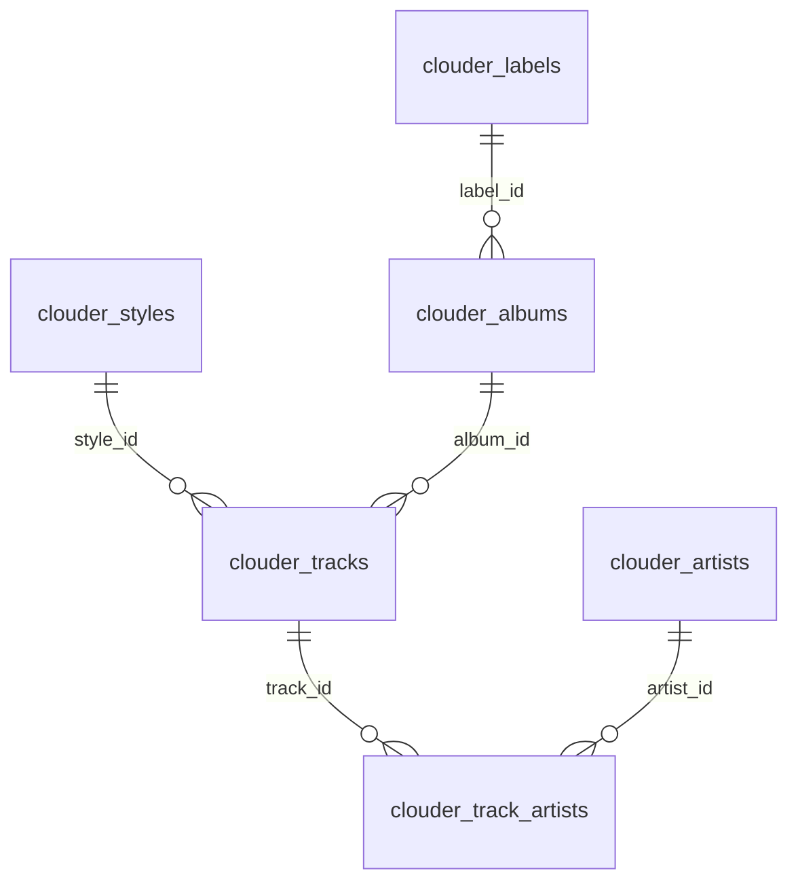
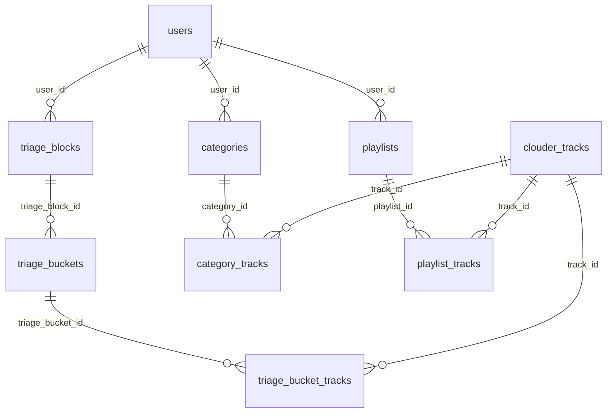

# Data model

Aurora PostgreSQL 16, database `clouder`. All PKs are UUID (String(36)). Timestamps are `TIMESTAMPTZ`.

Source: `src/collector/db_models.py`.

---

## Domain map

```
External sources (Beatport, Spotify)
        |
        v
   Source layer          raw representation
   ─────────────         before canonicalization
   ingest_runs
   source_entities
   source_relations
        |
        | identity_map  (source × entity_type × external_id) → clouder_id
        v
   Canonical layer       de-duplicated, vendor-neutral
   ─────────────
   clouder_labels
   clouder_styles
   clouder_artists
   clouder_albums
   clouder_tracks
   clouder_track_artists
        |
        v
   Enrichment            label/artist research; vendor match cache
   ─────────────
   clouder_label_info / clouder_artist_info
   vendor_track_map
   match_review_queue
        |
        v
   Triage / Curation     per-user overlays (ADR-0002)
   ─────────────
   triage_blocks / triage_buckets / triage_bucket_tracks
   categories / category_tracks
   playlists / playlist_tracks
   user_tags / track_tags
```

---

## Source layer

### ingest_runs

One row per Beatport API pull.

| Column | Type | Notes |
|---|---|---|
| run_id | String(36) PK | UUID |
| source | String(32) | `beatport` |
| style_id | Integer | Beatport genre ID |
| iso_year / iso_week | Integer nullable | Legacy ISO-week path |
| week_year / week_number | Integer nullable | Saturday-week path (ADR-0003) |
| period_start / period_end | Date nullable | Effective date window |
| is_custom_range | Boolean | True when caller overrides the derived window |
| raw_s3_key | Text | S3 key of `releases.json.gz` |
| status | String(32) | `RAW_SAVED` → `COMPLETED` \| `FAILED` |
| item_count / processed_count | Integer | Track counts |
| started_at / finished_at | TIMESTAMPTZ | |
| error_code / error_message | nullable | Set on failure |
| meta | JSONB | Freeform context captured at ingest time |

### source_entities

Raw payloads from any source, keyed by `(source, entity_type, external_id)`.

| Column | Type | Notes |
|---|---|---|
| source | String(32) | `beatport` or `spotify` |
| entity_type | String(32) | `track`, `artist`, `album`, `label`, `style` |
| external_id | String(64) | Source-specific ID |
| name / normalized_name | Text nullable | |
| payload | JSONB | Full source object |
| payload_hash | String(64) | SHA-256 of canonical JSON for change detection |
| first_seen_at / last_seen_at | TIMESTAMPTZ | |
| last_run_id | String(36) FK → ingest_runs | nullable for Spotify rows |

Index: `idx_source_entities_run` on `last_run_id`.

### source_relations

Entity-to-entity relationships in source terms. PK is the full 6-tuple.

| Column | Notes |
|---|---|
| source | |
| from_entity_type / from_external_id | |
| relation_type | `track_artist`, `track_album`, `album_label`, `track_style` |
| to_entity_type / to_external_id | |
| last_run_id | FK → ingest_runs |

---

## Canonical layer



### clouder_labels

| Column | Type | Notes |
|---|---|---|
| id | String(36) PK | |
| name / normalized_name | Text | `normalized_name` = lower + trim + collapsed whitespace |
| is_ai_suspected | Boolean default FALSE | Set by label enrichment (ADR-0008, ADR-0016) |
| ai_total / ai_checked / ai_tracks | Integer default 0 | AI reputation (migration 46): its tracks in CLOUDER, the ones `ai_lofcz` or `ai_deezer` checked (an `ok` row), the flagged ones. Recounted by `record_analysis_results` → `recount_ai_reputation` for the labels and artists of each results POST |
| ai_level | SmallInteger, generated | NULL without a flagged track; 1 = share of checked under 25%, 2 = 25–50%, 3 = over half. The SPA's monochrome AI badge; `ai_rep_sql` serves it as `{level, ai, checked, total}` |
| created_at / updated_at | TIMESTAMPTZ | |

### clouder_styles

Same shape as `clouder_labels` without `is_ai_suspected` and the `ai_*` columns, plus `is_hidden`
(Boolean default FALSE). An admin hides a style from the coverage matrix
popover (`PATCH /admin/styles/{style_id}`); hidden styles never come back
from `GET /styles`, but their tracks, runs and user selections are kept.

### clouder_artists

Same shape as `clouder_labels` including `is_ai_suspected` and the `ai_*` columns (an artist counts every track it is credited on, any role, once).

### clouder_albums

| Column | Type | Notes |
|---|---|---|
| id | String(36) PK | |
| title / normalized_title | Text | |
| release_date | Date nullable | From Beatport `publish_date` |
| label_id | String(36) nullable FK → clouder_labels | |
| release_type | String(16) nullable | `album` \| `single` \| `compilation`. Beatport does not expose this; populated from Spotify `album.album_type` during ISRC enrichment, then propagated from `clouder_tracks` via `propagate_release_type_to_albums` (ADR-0007). NULL until at least one track in the album has a successful Spotify lookup. |
| created_at / updated_at | TIMESTAMPTZ | |

Index: `idx_album_match (normalized_title, release_date, label_id)`. Canonicalization resolves albums through `identity_map`, not this index.

### clouder_tracks

| Column | Type | Notes |
|---|---|---|
| id | String(36) PK | |
| title / normalized_title | Text | |
| mix_name | Text nullable | e.g. `"Extended Mix"` |
| isrc | String(64) nullable | Partial index `idx_tracks_isrc WHERE isrc IS NOT NULL` |
| bpm / length_ms | Integer nullable | |
| publish_date | Date nullable | From Beatport |
| album_id | String(36) nullable FK → clouder_albums | |
| style_id | String(36) nullable FK → clouder_styles | |
| spotify_id | String(64) nullable | Partial index `idx_tracks_spotify_id WHERE spotify_id IS NOT NULL` |
| spotify_searched_at | TIMESTAMPTZ nullable | NULL = not yet searched; NOT NULL + spotify_id NULL = searched, not found |
| spotify_release_date | Date nullable | From `album.release_date` adjusted by `release_date_precision`. Partial index. Used by triage block classification: NULL→UNCLASSIFIED, before date_from→OLD, compilation→NOT, else→NEW |
| release_type | String(16) nullable | Mirror of parent album's `release_type` (ADR-0007) |
| is_ai_suspected | Boolean default FALSE | Dead: no writer, always FALSE; no API returns it. Kept only for the catalog export / `dim_track_history` |
| origin | Text default `'beatport'` | `beatport` \| `spotify_user_import` |
| created_at / updated_at | TIMESTAMPTZ | |

### clouder_track_artists

Junction table. PK is `(track_id, artist_id, role)`.

| Column | Notes |
|---|---|
| track_id FK → clouder_tracks | |
| artist_id FK → clouder_artists | |
| role | String(32) default `'main'` |

---

## Identity map

`identity_map` is the translation table between any external entity and its canonical CLOUDER counterpart.

PK: `(source, entity_type, external_id)`.

| Column | Type | Notes |
|---|---|---|
| source | String(32) | `beatport`, `spotify` |
| entity_type | String(32) | Source-side entity type |
| external_id | String(64) | Source ID |
| clouder_entity_type | String(32) | Canonical type |
| clouder_id | String(36) | UUID of canonical row |
| match_type | String(32) | `auto_create` (confidence=0.600), `isrc_match` (confidence=1.000) |
| confidence | Numeric(4,3) | |
| first_seen_at / last_seen_at | TIMESTAMPTZ | |

Index: `idx_identity_map_clouder (clouder_entity_type, clouder_id)` — reverse lookup.

**Write path**: `Canonicalizer` claims identities with `claim_identities` (`ON CONFLICT DO NOTHING`), reads the winners back, and creates canonical rows only for ids it won (ADR-0022). Claims and canonical rows share one `repository.transaction()` block, so they commit or roll back together.

**Read path**: `find_identities(source, entity_type, external_ids, transaction_id=)` — the `transaction_id` parameter is mandatory when called inside an active `repository.transaction()` block. Omitting it means the read issues against a separate Data API connection and misses in-flight writes: the identities just claimed do not resolve and the canonicalizer raises (the phase rolls back). See `src/collector/canonicalize.py` and `docs/backend/data-api.md`.

---

## Triage and curation overlays

All triage and curation tables are per-user. The canonical layer is shared; overlays are user-scoped.



### triage_blocks

One triage session per `(user_id, style_id, date window)`. State machine: `IN_PROGRESS → FINALIZED` (no re-open). Soft-deleted via `deleted_at`.

### triage_buckets

Each block has five fixed-type buckets (`NEW`, `OLD`, `NOT`, `DISCARD`, `UNCLASSIFIED`) plus N `STAGING` buckets — one per live category in the style at creation time. A `STAGING` bucket must have a non-null `category_id`; the coupling check is enforced at DB level.

`inactive=true` is set when the linked category is soft-deleted. `ON DELETE RESTRICT` on the `category_id` FK prevents silent nulling (which would break the check constraint).

### triage_bucket_tracks

PK `(triage_bucket_id, track_id)`. `ON CONFLICT DO NOTHING` makes moves idempotent at the call site.

**AI rule (2026-10-23).** A track that `ai_lofcz` or `ai_deezer` flags (any badge level) goes to `DISCARD`. It is the block option `triage_blocks.ai_to_discard`: on by default, a visible switch in the create dialog like the disliked labels / artists ones (migration 44; existing blocks kept it on).
- `create_block` classifies it there first, before likes and dates.
- A flagged result from the analyzer (`record_analysis_results` → `discard_ai_tracks`) moves it to `DISCARD` in every open block that keeps the option, from any bucket (`STAGING` too).
- A flagged track kept in a category leaves the category for the `DISCARD` bucket of its `source_triage_block_id` block, unless that block opted out (nowhere when it was added by hand). That user's tags on it go with the membership.
- Finalized blocks and playlists are not touched.

**AI labels / artists → NOT (migration 46).** `triage_blocks.ai_labels_min_level` / `ai_artists_min_level` (1–3, NULL = off, the create dialog's "From level N" selects, default off): at creation a track whose label, or any of whose artists, has `ai_level` ≥ that level goes to `NOT`, in the dislikes' tier (after the AI → `DISCARD` rule and likes → `FAV`). Only at creation; a later level change moves nothing. SQL fragments: `curation/triage_classify.py`.
- Migration 43 applied the rule once to the existing rows.

### categories

Permanent per-`(user_id, style_id)` track libraries. Soft-deleted via `deleted_at`. `position` is user-controlled. Unique constraint on `(user_id, style_id, normalized_name) WHERE deleted_at IS NULL`.

### category_tracks

PK `(category_id, track_id)`. `source_triage_block_id` is set when the track was promoted from triage finalize; null for direct adds.

### playlists / playlist_tracks

`playlists`: per-user named playlists, optionally synced to Spotify (`spotify_playlist_id`). Status: `active` | `completed`. Soft-deleted.

`playlist_tracks`: ordered membership. `position` has a deferrable unique constraint on `(playlist_id, position)` to allow bulk reorder within a transaction.

### Vendor match tables

`vendor_track_map` — PK `(clouder_track_id, vendor)`. One row per track per vendor. Idempotent upsert. `match_type`: `isrc`, `fuzzy`, `manual`. See `search-and-enrichment.md`.

`match_review_queue` — low-confidence candidates awaiting manual approval. Partial unique index `uq_review_pending (clouder_track_id, vendor) WHERE status='pending'` prevents duplicate pending entries.

### Audio analysis tables

| Table | Key | Notes |
|---|---|---|
| `track_analyses` | `(track_id, analyzer)` | One row per track and analyzer. Status is `leased` (with `lease_id` / `leased_until`, 30 min), `ok`, `failed` (final) or `unusable_source`. Also holds `version`, `result jsonb`, `audio_sha256`, `video_id` and `analyzed_at`. The partial index `ix_track_analyses_ai_flag` on `(track_id, analyzer)` over ok AI-flagged rows serves the `ai_verdict` level in the track lists (`ai_lofcz` + `ai_deezer`: both → `high`, lofcz only → `medium`, deezer only → `low`; migration 40; it replaced the lofcz-only index). Cascades on track delete. |
| `analysis_service_state` | `service` | The analyzer's heartbeat for the admin card: `last_claim_at`, `last_result_at`, and `claim_analyzers` (the names it asked for). |

**Claim order (2026-10-23).** `claim_analysis` hands out the tracks waiting in an open triage block first: any user, any bucket but `DISCARD`, because they are what the owner is about to triage. The rest of the catalog comes after them. Within each group the newest release goes first.

### Triage suggestions tables (migration 45)

| Table | Key | Notes |
|---|---|---|
| `audio_features` | `video_id` | Marks a YouTube video whose `light-1` profile (16 778 float16, `features/light-1/<video_id>.f16` in S3) exists. `version`, `audio_sha256`, `created_at`. |
| `audio_waveforms` | `video_id` | The player's waveform of a YouTube video (migration 48), posted by the analyzer for every video it downloads; `POST /v1/analysis/waveforms` also marks the video's tracks `waveform ok` in `track_analyses` (a re-match moves the row like `light_profile`), so tracks without one can be claimed later. `data` is base64 of `wave-1`: 3 bands (20–250 Hz, 250 Hz–4 kHz, 4–16 kHz) × 600 time bins of u8 dB against the band's loudest bin (0 = 36 dB below). `duration_ms` is the decoded length: `GET /tracks/{track_id}/waveform` returns the waveform only when the Spotify track's `duration_ms` is within 3 s of it. `version`, `audio_sha256`, `created_at`. |
| `ml_models` | `(user_id, style_id)` | One model per user and style. `version = 0` means requested, never trained. Also `trained_at`, `retrain_requested_at`, `n_labels`, `n_keep`, `keep_threshold`, `classes jsonb`, `metrics jsonb`, `artifact_key`. Cascades on user delete. |
| `track_predictions` | `(user_id, style_id, track_id)` | Scores of the current model: `model_version`, `keep_score`, `keep`, `categories jsonb`, `scored_at`. Cascades on user and track delete. |

### User tag tables

`user_tags`: per-user custom tags (name, optional color).
`track_tags`: PK `(user_id, track_id, tag_id)`.

---

## Multi-tenant overlay model

CLOUDER uses a shared canonical core with per-user overlay tables. See ADR-0002 for the full rationale.

- `clouder_*` tables are shared across all users. No user FK on canonical rows.
- `triage_blocks`, `categories`, `playlists`, `user_tags` are per-user. Every row carries `user_id`.
- `category_tracks`, `triage_bucket_tracks`, `playlist_tracks` are user-scoped through their parent table.
- One Aurora database (`clouder`). Row-level access control is enforced in the application layer (handler + repository queries filter by `user_id` from JWT context).
